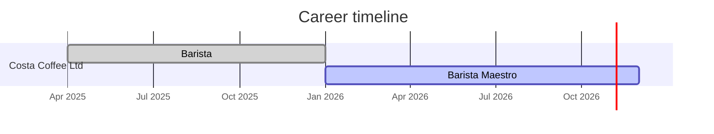
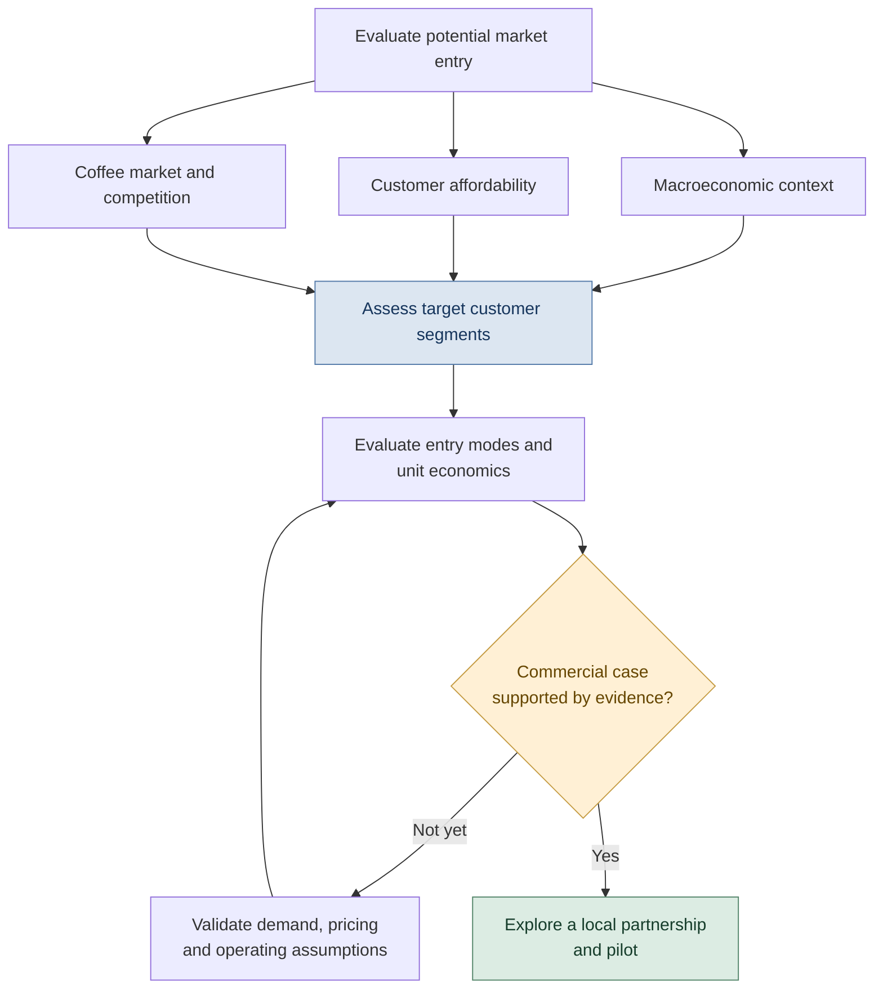
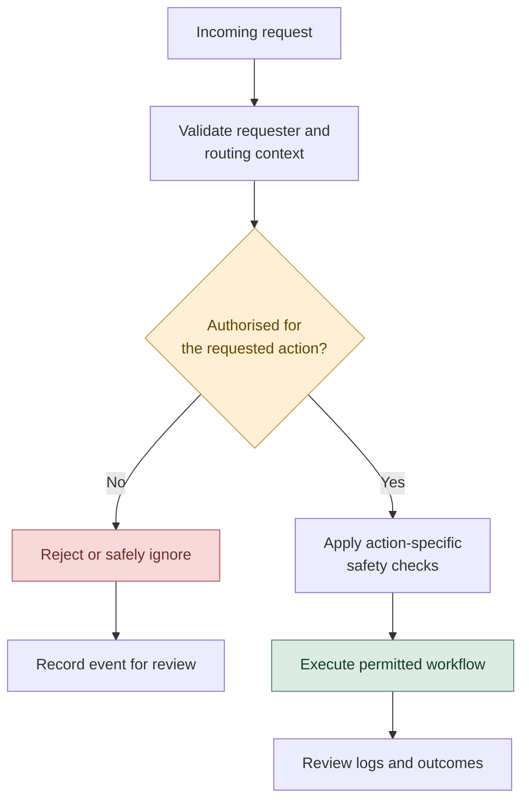
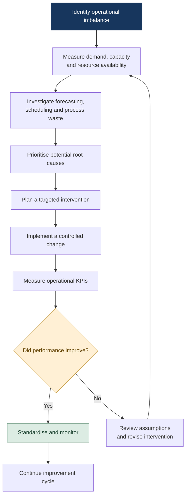

# Subash Gauchan
### Entry-Level Data Analyst | Business Analysis | BI & Operations Improvement

> A hands-on portfolio exploring business intelligence, sales and KPI analysis, market-entry research, operational improvement, AI workflow controls, and exploratory financial forecasting. Built through independent learning alongside a BSc (Hons) Applied Management degree, with project methods, findings, and limitations documented transparently.

**Website:** [subashgauchan16.github.io/SubashGauchan-Data-Analytics-Portfolio](https://subashgauchan16.github.io/SubashGauchan-Data-Analytics-Portfolio/) · **Repository layout:** `site/` is the published website; `data/` holds the source workbooks, `docs/` the audit and reconciliation notes, `source/` the 3D chart build, and `reference/` archived earlier versions. Only `site/` is deployed.

**Connect with me on LinkedIn:** [Subash Gauchan](https://www.linkedin.com/in/subash-gauchan16/)

  
  
  
  

---

<table>
  <tr>
    <td>
      <h2>My Journey into Data Analytics</h2>
      
<strong>From Excel 2016 on an ageing Dell laptop to building analytical projects—one lesson at a time.</strong>

      
About five months ago, I was building my first dashboard. I was an Applied Management student with no traditional technical background, an old Dell laptop that struggled to keep up, and no perfect roadmap into analytics. I had curiosity, a lot to learn, and a decision to start before I felt ready.

      
I taught myself Excel one function at a time: experimenting, getting stuck, searching for answers, and trying again. That first dashboard took weeks of trial and error, but it showed me that I could turn independent learning into something practical.

      
Since then, I have pushed beyond spreadsheets into Power BI, SQL fundamentals, data-quality checks, automated testing, and AI-assisted financial forecasting. Along the way, I have learned that analytics is not just about making numbers look impressive. It is about asking the right questions, checking whether the data can be trusted, and being honest about what the evidence does—and does not—show.

      
I have prioritised hands-on projects over collecting certificates alone. Each project gives me something concrete to test, document, improve, and learn from. I am still developing my skills, and I see that as part of the work—not something to hide.

      
As a business student, I want to connect analytical thinking with commercial understanding, especially in banking and financial services, where accuracy, accountability, and sound decisions matter.

      <blockquote><strong>This repository is more than a collection of dashboards. It is a record of where I started, what I have taught myself, the mistakes that have helped me improve, and the questions I am learning to answer.</strong></blockquote>
      
I do not claim to know everything. Five months ago, I was figuring out my first dashboard. Today, I am building more structured analytical workflows—and I am only getting started.

    </td>
  </tr>
</table>

## At a glance
- BSc (Hons) Applied Management student (BPP University). Open to entry-level/graduate roles in Data Analysis, Business Analysis, Business Intelligence and Operations Analysis.
- Core tools: Excel (PivotTables, lookups), Power BI, SQL basics; familiar with PDCA, 4Vs and TIMWOODS for operational analysis.
- This portfolio documents coursework and independent projects. Evidence status (data, workbooks) is noted per project below.

---

## About me

I am a BSc (Hons) Applied Management student at BPP University, interested in using data to understand business performance, investigate operational problems and support evidence-based decisions.

My approach combines business understanding with practical analytics. I use Excel and Power BI to structure information, analyse KPIs and communicate findings, while developing my SQL and quantitative skills.

My projects explore commercial performance, market-entry strategy, operational improvement and the responsible use of AI workflows. I aim to go beyond reporting what happened by asking why it may have happened and what to do next.

**Career interests:** Data Analysis · Business Analysis · Business Intelligence · Operations Analysis · Research Analysis

## Learning by building: my approach to AI-assisted development

I am largely self-taught, and AI-assisted development has become one of the ways I learn. I sometimes call it *vibe coding*, but I do not see the process as simply asking an AI tool to generate code and accepting whatever comes back. I start with a problem, explain the context, work through the logic, build a practical solution, and then test where it works and where it falls short.

For example, I am building [CurioTrail](https://subashgauchan16.github.io/CURIO/), a story-driven learning game that turns concepts such as SQL, Python, Excel and KPI analysis into interactive challenges. I learn by experimenting with ideas and building things I can use to practise them. AI tools can accelerate implementation, but I remain responsible for checking the behaviour, understanding the decisions I can explain, and being clear about limitations.

That approach connects with how I think about analysis: begin with a real problem, gather context, reason through possible solutions, test assumptions and improve the result. Analysts cannot prevent every business problem, but they can help identify risks earlier, investigate root causes and support better-informed decisions before issues become more costly.

**What I am practising:**
- **Problem framing:** define what needs to be solved and why it matters.
- **Logical decomposition:** break an idea into inputs, rules, outputs and edge cases.
- **Testing and iteration:** challenge assumptions, investigate failures and improve the solution.
- **Responsible AI use:** use AI to accelerate work without treating its output as automatically correct.
- **Learning through application:** turn abstract concepts into tools and exercises I can experiment with.

I do not claim to have written every line of every AI-assisted project from scratch. My aim is to be transparent about the tools I use, understand the system's key logic and limitations, and demonstrate my contribution through the problem definition, decisions, testing and improvements.

## Analytical approach

My workflow connects business questions to evidence and measurable decisions.

## Core skills

| Area | Skills and tools |
|---|---|
| Data analysis | Excel, PivotTables, SUMIFS, INDEX/MATCH, lookup functions, KPI reporting |
| Business intelligence | Power BI, dashboard design, performance monitoring, data visualisation |
| Quantitative methods | Descriptive statistics, trend analysis, hypothesis development, quantitative and qualitative research |
| Database foundations | SQL fundamentals and SQLite |
| Business and operations | PDCA, 4Vs, TIMWOODS, market-entry analysis, process improvement |
| Project analysis | Critical-path analysis, earned value management concepts, risk and performance assessment |
| Communication | Business reporting, insight communication, stakeholder support, coaching and collaboration |

*Skills are listed at their current practical level. Statistical modelling, regression and advanced forecasting are areas for continued development where not yet independently validated.*

-## Career timeline
 

 
---

## Featured projects

## CurioTrail — A story-driven learning game

**[▶ Play CurioTrail directly](https://subashgauchan16.github.io/CURIO/)** · [View the source code](https://github.com/subashgauchan16/CURIO)

*Best viewed on a modern browser; this prototype is still being iterated. A verified project screenshot will be added when one is available.*

CurioTrail is an AI-assisted, self-directed learning project that turns technical concepts into interactive challenges. It is designed to help non-technical learners practise SQL, Python, Excel formulas and KPI analysis through a game-style experience rather than only reading explanations.

I use the project to learn by building: defining the problem, breaking concepts into logic, experimenting with implementation, testing behaviour and improving the experience. AI tools support parts of development, but I do not treat generated output as automatically correct. I aim to understand the key logic, verify what I can and document limitations honestly.

**What this project demonstrates:** product thinking, learning-by-building, structured problem-solving, iterative testing and transparent AI-assisted development.

> **Try it:** Open the live game above. The prototype is a work in progress; rendering performance can vary by device and graphics hardware.

---

## 1. Starbucks Nepal — Market-entry and affordability analysis

**Tools:** Excel · Strategic analysis · Macroeconomic research

### Business question

How could Starbucks evaluate a potential Nepal entry while accounting for premium positioning, local market conditions and customer affordability?

### Key analytical finding

The available project evidence does not verify a monthly-income affordability estimate for Nepal or the United States.

The project workbook contains a separate GDP-per-capita proxy; this is not a measure of monthly individual or household affordability.

**Evidence status:** The original affordability calculations and supporting inputs could not be verified from the available project evidence. The headline corporate statistics below are externally verifiable from Starbucks filings (linked).

**Authoritative corporate sources (Starbucks FY2025):**
- [Starbucks FY2025 results (official press release)](https://investor.starbucks.com/news/financial-releases/news-details/2025/Starbucks-Reports-Q4-and-Full-Fiscal-Year-2025-Results/default.aspx)
- Starbucks FY2025 Form 10-K — consult the annual report for detailed disclosures.

The official FY2025 results report **40,990 stores** at fiscal year-end, **US$37.2 billion in consolidated net revenue**, and a **7.9% GAAP operating margin**, down **710 basis points year over year**. These are global corporate figures; they do not establish Nepal-specific demand, affordability or commercial viability.

**Macroeconomic proxies:**
- Nepal GDP per capita (current US$) — World Bank / country data: https://data.worldbank.org/indicator/NY.GDP.PCAP.CD?locations=NP
- United States GDP per capita (current US$) — World Bank / country data: https://data.worldbank.org/indicator/NY.GDP.PCAP.CD?locations=US

> Note on income measures: GDP per capita, median household income, disposable income and individual wages are distinct measures. Affordability results depend strongly on which income measure is used; GDP per capita is a broad economic average and does not equal typical household or individual earnings.

### Affordability (current repository status)

| Location | Monthly affordability result | Evidence status |
|---|---|---|
| Nepal | Not reported | Original calculation and inputs not verified |
| United States | Not reported | Original calculation and inputs not verified |

*How to validate:* provide the original calculation model or a reproducible table listing each drink price, product size, location and date; currency and exchange-rate source; comparable monthly income measures and citations; and the calculation cells.

### Decision framework

### Business implication

Affordability remains a question to validate for a premium coffee proposition. A local partnership may help evaluate market knowledge and operating fit, but this is a proposal to be tested rather than a concluded strategy.

**What this project demonstrates:** Market research, strategic reasoning and evidence-focused recommendations.

---

## 2. Online Store Dashboard — First Excel Analytics Project

**Status:** Foundational project · Excel 2016

**Tools:** Excel 2016 · PivotTables · PivotCharts · SUM / SUMIF · COUNT · INDEX · GETPIVOTDATA · TEXT functions · KPI reporting

### Project overview

This was my first data analytics dashboard, built while independently learning Excel 2016 as a BSc (Hons) Applied Management student at BPP University. I used an online-store dataset to practise turning sales records into a visual overview of commercial performance.

### Business questions explored

- How do revenue and delivered-order revenue compare?
- Which product categories contribute most or least to recorded sales?
- How do sales channels and payment methods compare?
- What patterns appear across quarters and delivery performance?
- Which areas might deserve further investigation by the business?

### Headline results from the original dashboard

| Finding | Dashboard result |
|---|---:|
| Gross revenue | £1,264,761.96 |
| Net revenue from delivered orders | £242,600.32 |
| Average order value | £1,053.97 |
| Highest-sales quarter | 2024 Q2: £145,590.79 (the original dashboard showed £145,412.78, the 2023 Q1 value) |
| Highest product revenue | Chairs: approximately £195.6K |
| Lowest product gross revenue | Phones: approximately £151.7K |
| Lowest product net revenue | Desks: approximately £24.2K |
| Leading channel | Instagram by gross order value (£275,285); Email by delivered value (£64,554). The original dashboard showed Email only |

These figures were recomputed from the 1,200 orders in the workbook in October 2026; the two rows the original dashboard got wrong are corrected above. Amounts are shown in £ because the workbook formats them that way; it has no currency field, and it is a practice dataset rather than business accounts.

### What I learned

Building this dashboard helped me practise Excel formulas, PivotTables, PivotCharts, KPI presentation and translating results into business questions. The recommendations explored included investigating weaker product performance, reviewing marketing-funnel conversion and considering inventory turnover and working-capital efficiency. These were hypotheses to investigate, not measured improvements.

**Reflection:** This project was the starting point of my analytics journey. Since then, I have continued working on more structured sales and financial performance analysis, including explicit data-quality checks and documented limitations.

**What this project demonstrates:** Independent learning, foundational Excel analytics, dashboard design and communicating exploratory findings in a business context.

---

## 3. Sales Analytics — Financial Performance & Market Strategy

**Status:** In progress

**Tools:** Excel · PivotTables · Lookup Functions · KPI Dashboards · Heatmap Analysis

### Business question

How does financial performance change over time, which countries and product categories drive results, and where could the business improve its commercial strategy?

### Project overview

An Excel-based sales analytics project exploring historical financial performance and comparing markets by revenue, cost and profit. The dashboard brings together year-level financial analysis, a heatmap and country-level performance views to identify patterns that may inform resource allocation, product focus and cost-management decisions.

### Key findings from the workbook

The raw-data sheet contains **113,036 populated transaction records**. The headline totals and product/country breakdowns below were recalculated from the workbook's raw records. The source currency and formal definition of the `Profit` field are not documented, so values are shown in source units rather than assumed to be GBP.

| Finding | Workbook result | Business interpretation |
|---|---:|---|
| Total revenue | 85,271,008 | Total recorded sales value |
| Total cost | 53,049,908 | Total recorded cost |
| Recorded profit | 32,221,100 | Total from the workbook's Profit field |
| Profit-to-revenue ratio | 37.8% | Descriptive ratio; not labelled gross margin |
| Bikes revenue | 61,782,134 (72.5%) | Dominant product category by revenue |
| Accessories revenue | 15,117,992 (17.7%) | Second-largest category by revenue |
| Clothing revenue | 8,370,882 (9.8%) | Smallest category by revenue |
| Highest-revenue country | United States: 27,975,547 (32.8%) | Largest market by recorded revenue and profit |
| Highest country profit-to-revenue ratio | Canada: approximately 46.8% | Candidate for further investigation into product mix and costs |

### Dashboard analysis

**Financial performance over time:** The financial dashboard compares revenue, cost and profit by year, with a heatmap to make differences across periods easier to spot. This view is intended to flag periods for further investigation—for example, when costs change differently from revenue or profit. Annual comparisons remain provisional until the date and pivot inconsistencies described below are reconciled.

**Country-level performance:** The country view compares revenue, cost, profit and profitability measures to distinguish market scale from relative performance. The United States records the highest revenue (27.98m) and profit (11.07m); Australia is second by revenue (21.30m). Canada has the highest calculated profit-to-revenue ratio among the six countries (approximately 46.8%). These results help prioritise questions for investigation, but do not by themselves explain why markets perform differently.

**Product mix and market strategy:** Bikes represent approximately **72.5% of revenue** and **63.7% of the recorded profit field**. Accessories contribute 17.7% of revenue, while Clothing contributes 9.8%. Combining product and country views can help investigate which categories contribute most in each market and where complementary-product opportunities may exist.

### Potential business actions to investigate

- **Markets with high sales and profit:** identify the product categories contributing to performance before considering additional stock, marketing or investment.
- **Markets with high costs:** break costs down by year and product category, then investigate potential drivers before proposing changes to pricing, sourcing, inventory or operating processes. High total cost alone does not indicate poor performance if sales are also high.
- **Markets with stronger calculated ratios:** compare category mix and cost patterns to identify practices worth testing elsewhere; do not assume that results will transfer between markets.
- **Cross-selling opportunities:** test whether Accessories or Clothing could be promoted alongside Bikes in markets where the category-level evidence supports further investigation.

These are potential actions suggested by exploratory analysis, not proven causes or guaranteed outcomes. A specific recommendation for the country with the highest cost will be made after that country is confirmed from the dashboard and its revenue, profit, ratio and product mix are compared.

### Data quality and reporting limitations

Year-level reporting needs reconciliation before it can support reliable trend conclusions. Grouping the raw `Date` field gives recorded revenue of 8.96m (2011), 9.18m (2012), 15.24m (2013), 14.15m (2014), 20.02m (2015) and 17.71m (2016). However, the workbook's annual pivot summary reverses the 2011 and 2012 labels and does not exactly match the raw-date aggregation for 2013. **2014 and 2016 contain January–July records only**, so full-year comparisons involving those years (including an apparent 2016 decline) are not like-for-like. One transaction is dated **1906-09-02** despite the stated 2011–2016 reporting period, and **5,354 values** in the `Year` column are stored as dates rather than year numbers.

The source currency, formal definition of `Profit`, duplicate-record handling and annual date logic have not been independently verified. The profit-to-revenue ratios are calculated descriptive measures, not independently verified accounting margins. The annual figures should be treated as diagnostic comparisons until the reporting logic is reconciled.

**Next steps:** reconcile date fields and annual summaries; confirm financial measure definitions; validate the dashboard calculations; and drill into country-by-category performance to test which product and cost-management strategies are supported by the data.

See the [workbook data-quality audit](./docs/workbook_data_quality_audit.md) for the detailed review and the [conservative remediation workflow](./docs/sales_data_quality_review.md) for a documented, non-destructive approach to investigating the date anomalies.

**What this project demonstrates:** Excel-based KPI analysis, financial performance comparison, heatmap interpretation, product-mix analysis, data-quality investigation and commercially focused problem framing.

---

## 4. AI Agent Workflow — Authorisation and safety controls

**Focus:** Workflow design · Risk awareness · Process review

### Business question

How can an AI-assisted workflow distinguish permitted requests from unauthorised actions and make its control boundaries more explicit?

### Control design

### Key insight

A workflow can function correctly under normal conditions and still contain an authorisation weakness. Access checks must be applied before protected actions, with appropriate logging and testing.

In my practical workflow exploration, I investigated an authorisation boundary issue and added a guard against unauthorised handling. The README now clarifies which parts are implemented and which are conceptual.

**What this project demonstrates:** Workflow reasoning, risk identification, control design and an interest in responsible AI adoption.

---

---

## 6. AI-Assisted Financial Forecasting — Walk-forward model review

**Tools and methods:** Quantcept historical market data · Claude-assisted reporting · Ridge regression · baseline comparison · chronological walk-forward evaluation

### Business question

Can a Ridge regression model improve on a simple baseline when forecasting the 20-trading-day price change across multiple instruments and unseen yearly test periods?

### Headline results

| Metric | Simple baseline | Ridge regression | Interpretation |
|---|---:|---:|---|
| Return MAE | 4.10% | 4.09% | Practically indistinguishable in the aggregate |
| Price MAE | 251.9635 | 251.6687 | Slightly lower reported error; units differ by instrument |
| Directional accuracy | 57.68% | 52.94% | Ridge trails the baseline on direction |

### Forecast error over time

The error lines largely overlap, with both models' errors rising sharply in 2020. Ridge does not show a consistent, meaningful improvement over the baseline.

### Directional accuracy over time

The model beats the baseline in only two test years in the report. Overall, Ridge's directional accuracy is lower than the baseline's, so the forecast should not be treated as a reliable market-direction signal.

### Latest forecast versus typical error

The reported forecast moves are small relative to typical model error. This weak signal-to-error comparison is another reason not to interpret these outputs as actionable trading recommendations.

### What I learned

- Why chronological splits and year-by-year walk-forward evaluation are important for time-series work.
- Why a model needs to be compared with a clearly defined baseline using the same test observations.
- Why numerical error and directional accuracy measure different aspects of forecast quality.
- How AI-assisted reporting can help communicate findings, while the analyst remains responsible for checking the metrics and limiting claims.

### Limitations and status

This is an **exploratory prototype**, not a validated trading strategy. The report's figures have not been independently audited. Further checks should verify target definitions and units, sample sizes, forecast/target alignment, overlapping horizons, treatment of corporate actions and dividends, the partial 2026 test period, and reproducibility of the evaluation. BP and Shell price series may use different adjustment conventions and are not directly comparable.

**Conclusion:** The current evaluation does not demonstrate a reliable predictive edge or investment profitability. This project demonstrates an analytical workflow and critical model evaluation—not investment advice.

**Full HTML report:** [Walk-Forward Forecast Review](https://subashgauchan16.github.io/SubashGauchan-Data-Analytics-Portfolio/projects/forecasting/walk-forward-review.html) — the charts and key insights above are also visible directly in this README without opening the report.

## 5. Green Motion — Operations analysis and improvement proposal

**Focus:** Operations management · PDCA · Forecasting · Process analysis

### Business question

How can operational imbalances and potential forecasting weaknesses be investigated systematically?

### Improvement framework

### Key insight

Frameworks such as PDCA, 4Vs and TIMWOODS can structure an operational investigation, but a framework alone does not demonstrate an improvement. The outcome should be evaluated through appropriate before/after KPIs.

Potential measures include utilisation, forecast error (e.g. MAPE), turnaround time and resource imbalance, depending on the data available.

**What this project demonstrates:** Operations analysis, structured problem-solving and the translation of business frameworks into practical improvement proposals. This coursework does not report a measured productivity improvement.

---

## Education

**BSc (Hons) Applied Management — BPP University**  
Expected completion: 2028

Relevant study areas include:

- Business Analytics
- International Business
- Operations Management
- Strategic Management
- Sustainability Management
- Organisational Behaviour
- Finance

---

## Professional experience

### Barista Maestro — Costa Coffee Ltd
**January 2026 – Present | Woking, Surrey**

- Monitor daily sales and product mix to support stock and staffing decisions.
- Identify operational issues and coordinate with colleagues to maintain service standards.
- Coach new team members on customer service, operational procedures and consistency.
- Support day-to-day decisions in a fast-paced customer-facing environment.
- Nominated for Costa Barista of the Year UK in 2026.

### Barista — Costa Coffee Ltd
**April 2025 – January 2026 | Woking, Surrey**

- Progressed to Barista Maestro within the first year.
- Developed experience in customer service, teamwork, operational consistency and handling competing priorities.

---

## What I bring to an analyst role

- A business-first approach to data and performance analysis.
- Experience connecting operational context with KPI reporting.
- A willingness to validate assumptions rather than overstate conclusions.
- Clear communication of findings, limitations and potential actions.
- A self-directed learning mindset across analytics, business intelligence and quantitative methods.

I am particularly interested in opportunities where I can combine analytical skills with business understanding, contribute to evidence-led decisions and develop through practical experience.

## Contact

- **Email:** [thakalidenil@gmail.com](mailto:thakalidenil@gmail.com)
- **LinkedIn:** [linkedin.com/in/subash-gauchan16](https://www.linkedin.com/in/subash-gauchan16/)
- **GitHub:** [github.com/denilthaks](https://github.com/subashgauchan16)
- **Location:** Woking, Surrey, United Kingdom

---

## Evidence and limitations

The project files included here do not verify every original calculation. The following checks remain necessary before the affected figures can support decisions:

1. **Starbucks Nepal:** Validate the original affordability model or provide a reproducible table listing drink price, product size, location/date, currency and exchange-rate source, comparable monthly income measures, citations and calculation cells. GDP per capita is a broad economic average, not a proxy for an individual's or household's monthly disposable income.
2. **Sales Analytics:** Confirm source currency, the definition of `Profit`, date treatment, repeated-row handling and aggregation logic; then reconcile cached pivot summaries against an approved calculation from the underlying records. Until then, do not use unreconciled sales trends to guide inventory or other operational decisions.

Monthly affordability estimates and sales growth percentages are withheld because their inputs or calculations have not been sufficiently verified. The preliminary 2011 and 2016 endpoint values, 37.8% Profit-to-Revenue ratio and 72.5% Bikes revenue share should be treated as workbook-derived exploratory results, not independently validated financial measures. In particular, the ratio is not labelled gross margin, and no source currency is assumed.

See the [workbook data-quality audit](./docs/workbook_data_quality_audit.md) for the sales-data limitations. Starbucks FY2025 corporate metrics are linked in the project section above and describe the global business, not Nepal-specific market demand.

---

  Open to entry-level, graduate and internship opportunities in Data Analysis, Business Analysis, Business Intelligence, Operations Analysis and Research Analysis.

